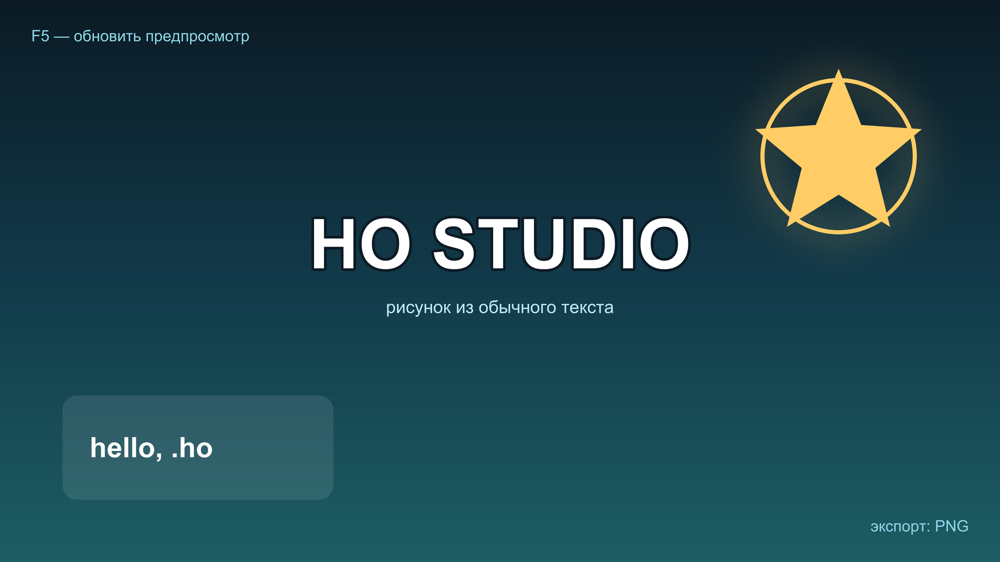

[README.md](https://github.com/user-attachments/files/34485952/README.md)
<p align="center">
  
</p>

<h1 align="center">HO Studio</h1>

<p align="center">Рисует изображения по текстовым командам формата <code>.ho</code></p>

## Что это такое

HO Studio — программа для Windows с графическим интерфейсом. Слева вы пишете команды, справа сразу видите картинку, готовый результат сохраняется в PNG.

Файл `.ho` — обычный текст: размер холста, фигуры, текст, цвета, тени и градиенты. Никаких внешних картинок и бинарных данных.

```ho
format 16:9
bg grad(#0b1a24, #123a4a, #1d5d63, v)

var accent #ffcc66

text 960 470 "HO STUDIO" size=132 color=#ffffff bold=true anchor=mm stroke=5 stroke_color=#0b1a24
text 960 590 "рисунок из обычного текста" size=34 color=#bfe9f2 anchor=mm
text 60 52 "F5 — обновить предпросмотр" size=30 color=#8fd6e6 anchor=lt
text 1860 1028 "экспорт: PNG" size=30 color=#8fd6e6 anchor=rb

circle 1610 300 150 fill=none outline=$accent width=8 glow=true glow_color=$accent glow_blur=34
star 1610 300 74 168 5 fill=$accent

rect 120 760 520 200 radius=28 fill=#ffffff opacity=0.10 outline=#ffffff width=2
text 172 860 "hello, .ho" size=54 color=#ffffff bold=true anchor=lm
```



## Возможности

- Предпросмотр обновляется по `F5` и подстраивается под размер окна.
- Правая кнопка в редакторе: копировать, вставить, выбрать всё, вставить цвет.
- Палитра цветов: готовые наборы, недавние цвета, системный выбор и копирование HEX.
- Координаты под предпросмотром: введите X и Y — на картинке появятся синие линии через эту точку. Наведение мыши показывает координаты под курсором, клик вставляет их в код.
- Ошибки не останавливают рендер: строка пропускается, причина с номером попадает в журнал.
- Две встроенные справки: `F1` — как пользоваться программой, `F2` — все команды формата.

## Как скачать

1. Открыть [Releases](../../releases/latest).
2. Скачать `HO-Studio.exe`.
3. Запустить двойным щелчком.

Установка не нужна, права администратора не требуются, Python на компьютере не нужен. При первом запуске Windows может показать «Windows защитила ваш компьютер» — нажать **Подробнее → Выполнить всё равно**.

## Горячие клавиши

| Клавиши | Действие |
|---|---|
| `F5` | обновить предпросмотр |
| `Ctrl+O` | открыть `.ho` |
| `Ctrl+S` | сохранить `.ho` |
| `Ctrl+E` | экспорт в PNG |
| `Ctrl+A` | выделить всё |
| `F1` | как пользоваться программой |
| `F2` | инструкция по формату |

## Важно знать

- Windows 10/11, 64 бита.
- Холст от 16 до 8000 пикселей по стороне, пресеты 16:9, 9:16, 1:1, 4:3.
- `.ho` сохраняется в UTF-8, поэтому русский текст работает без настроек.
- Ошибка в одной строке не останавливает рендер: строка пропускается, номер и причина появляются в нижней панели.
- Полная инструкция встроена в программу: **Справка → Инструкция по формату** (`F2`), справка по интерфейсу — `F1`.
